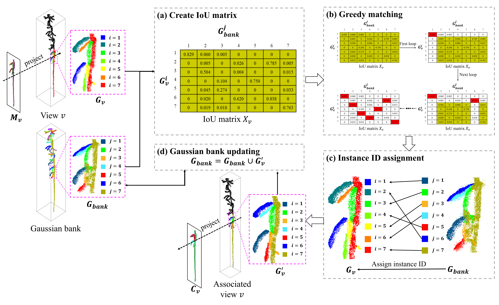
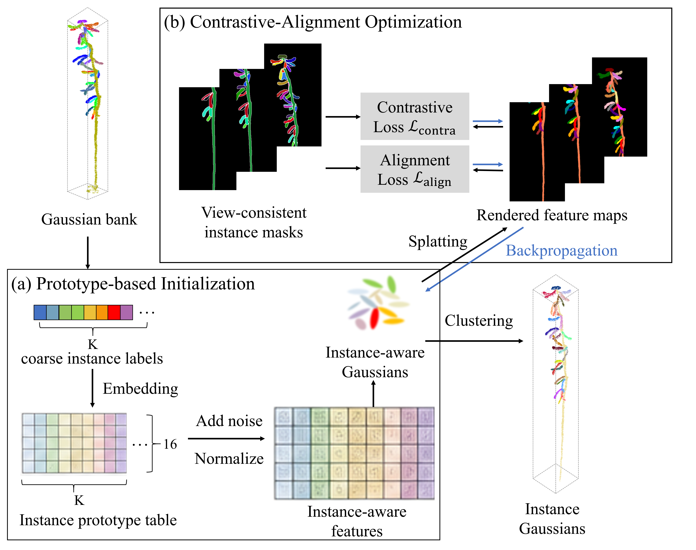
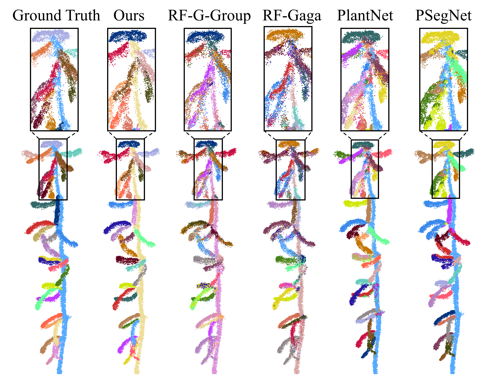
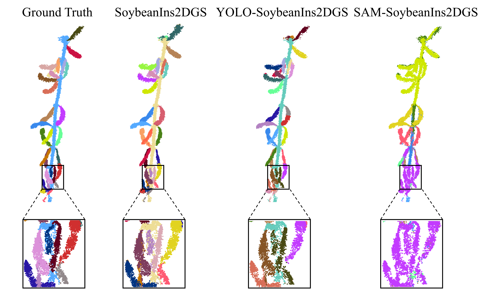
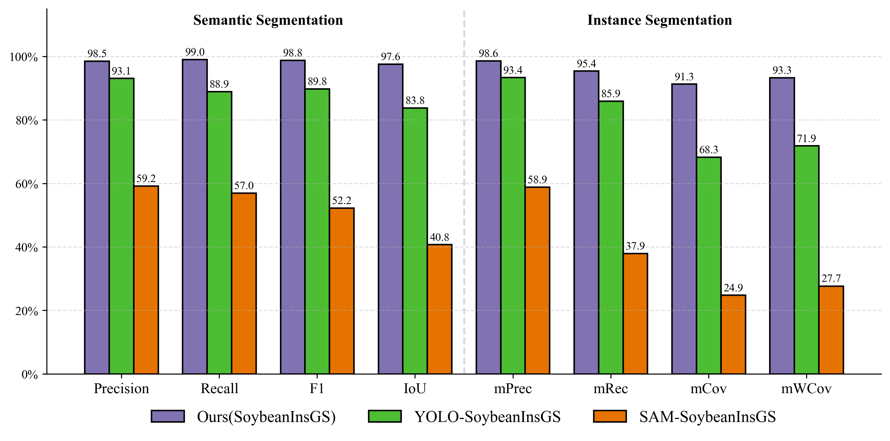
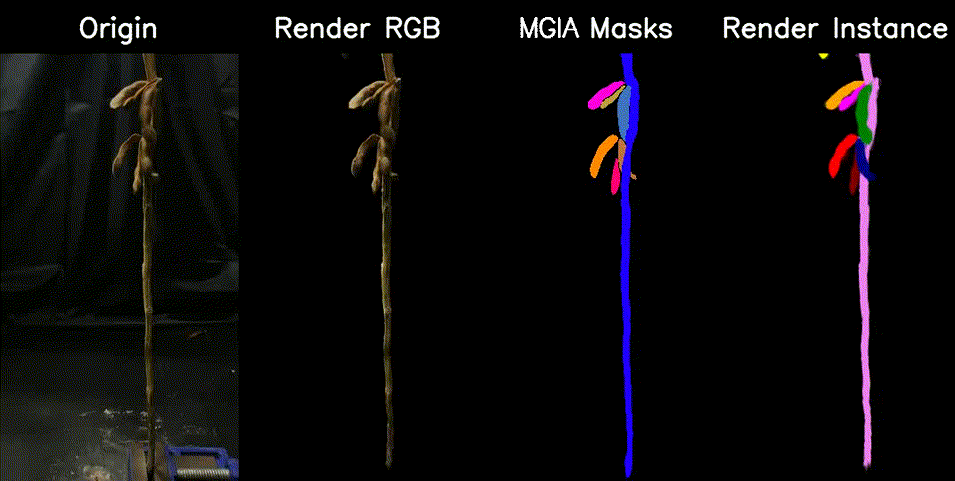
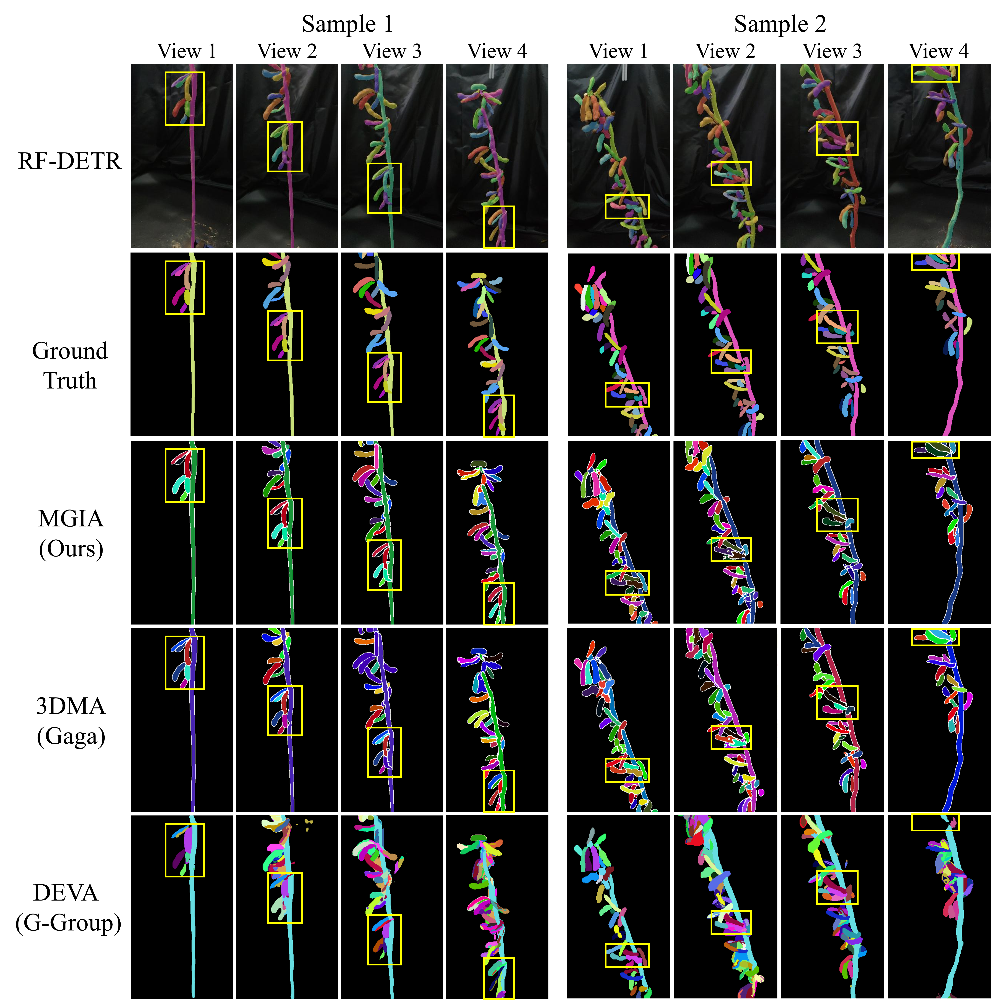
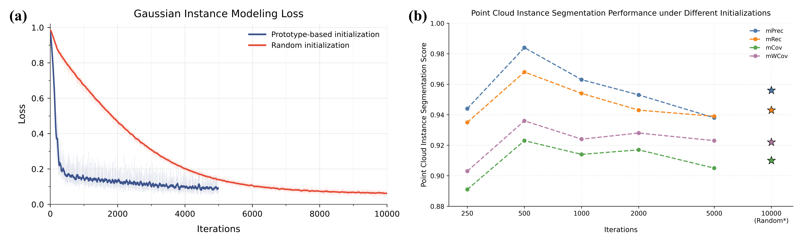
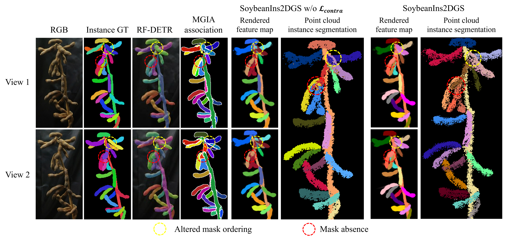
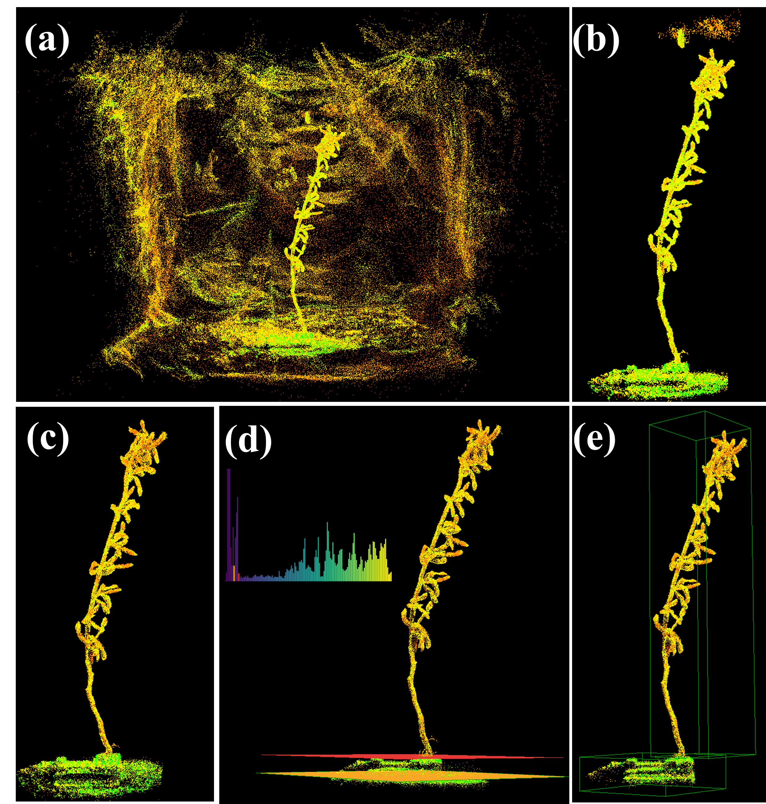

# SoybeanIns2DGS: Lifting multi-view 2D instance masks to instance-aware 2D Gaussians for mature soybean phenotyping 

## Methods

### Overview

The proposed Soybean Instance-aware 2D Gaussian Splatting (SoybeanIns2DGS) pipeline transforms organ-level multi-view 2D instance masks into instance-aware 2D Gaussians for mature soybean point cloud instance segmentation and phenotyping. As illustrated in Fig. 1, the pipeline follows a structured workflow: 

First, the Roboflow Detection Transformer (RF-DETR) model was trained to generate fine-grained instance masks of soybean pods and stems from individual RGB images (Fig. 1a), while the same multi-view images were used for 2DGS reconstruction (Fig. 1b). Camera poses and sparse point clouds were estimated using COLMAP (Schönberger and Frahm, 2016) to establish a high-fidelity 2DGS model. 

Second, the proposed mask-Gaussian instance association (MGIA) algorithm lifted view-wise instance masks into the reconstructed Gaussian space and updated a dynamic Gaussian bank to assign cross-view consistent instance IDs and generate coarse instance 2D Gaussians (Fig. 1c). 

Third, Gaussian instance modeling (GIM) was performed to refine the coarse instance 2D Gaussians (Fig. 1d). Prototype-based initialization first initialized learnable instance-aware features from the coarse instance 2D Gaussians, providing structured priors for optimization of instance -aware 2D Gaussians. These features were then refined with view-consistent 2D masks through contrastive-alignment optimization, which compacted Gaussians from the same organ instance and separated those from different instances in the learned feature space. 

Finally, organ-level point cloud instance segmentation was obtained by performing HDBSCAN clustering (Campello et al., 2013) to the optimized instance-aware Gaussians. Based on the segmented point clouds, key phenotypic traits were extracted and quantitatively validated against manual measurements.


Figure 1: The proposed soybean instance-aware 2D Gaussian Splatting (SoybeanIns2DGS) pipeline.

### MGIA: Mask-Gaussian instance association
We propose a novel mask-Gaussian instance association (MGIA) algorithm lift view-wise 2D masks into the shared Gaussian space, progressively update a Gaussian bank $G_{bank}$, and assign cross-view consistent instance IDs, as shown in Fig. 2. The final $G_{bank}$ was termed coarse instance Gaussians $G_{coarse}$ and used as the initialization prior for Gaussian instance modeling (GIM).




Figure 2: The proposed mask-Gaussian instance association (MGIA) algorithm.

### GIM: Gaussian instance modeling
We propose Gaussian instance modeling (GIM) method to convert the reconstructed 2DGS model into an instance-aware representation for organ-level point cloud instance segmentation. A learnable instance-aware feature vector $f_i \in \mathbb{R}^{D}$ was attached to each 2D Gaussian $g_i$, with $D=16$ in this study. As shown in Fig. 3, GIM consists of prototype-based initialization followed by contrastive-alignment optimization. Compared with random feature initialization adopted by Gaussian Grouping and Gaga, prototype-based initialization used $G_{coarse}$ generated by MGIA to provide instance-informed initial features for optimization of instance-aware 2D Gaussians $G_{ins}=\{(g_i, f_i)\}^N_{i=1}$.



Figure 3: The Gaussian instance modeling (GIM) method.

## Results
### Point Cloud Instance Segmentation


Figure 4: The point cloud instance segmentation results of the soybean plants.
### Comparison with YOLO- and SAM-based Variants

The following visualization compares organ-level instance segmentation of a mature soybean plant across the ground truth, SoybeanIns2DGS, YOLO-SoybeanIns2DGS, and SAM-SoybeanIns2DGS. The enlarged regions highlight differences in instance separation for closely spaced organs.



Figure 5: Qualitative comparison of soybean organ-level point cloud instance segmentation results, with zoomed-in views of challenging regions.

The figure below compares semantic segmentation performance (precision, recall, F1 score, and IoU) and instance segmentation performance (mPrec, mRec, mCov, and mWCov) for SoybeanIns2DGS and the YOLO- and SAM-based variants. The comparison illustrates differences in both semantic-level accuracy and organ-instance consistency.



Figure 6: Quantitative comparison of semantic and instance segmentation performance among SoybeanIns2DGS, YOLO-based, and SAM-based variants.

### Rendered Images


Figure 7: The rendered images of cross-view consistent instance masks of the soybean plants.

### Mask-Gaussian instance association


Figure 8: Comparison of cross-view instance ID assignment performance among MGIA, 3DMA, and DEVA.

### Gaussian instance modeling
#### Prototype-based Initialization



Figure 9: Effect of prototype-based initialization on Gaussian instance modeling and point cloud instance segmentation.

#### contrastive-alignment optimization



Figure 10: Visual comparison of rendered feature maps and point cloud instance segmentation results of SoybeanIns2DGS with and without contrastive learning. 

## Data Preparation:
We typically support data prepared as COLMAP format.


```
data/
├── scene_1                     # scene_1, scene_2, ... are different scenes (different soybean plants)
│   ├── images                  # images, images_2, images_4, and images_8 are the original images with different downsampling rates (1, 2, 4, and 8)
│   ├── images_2
│   ├── images_4
│   ├── images_8
│   ├── object_mask             # cross-view instance tracking results(gray), which are used as the supervision for training the instance-aware 3D Gaussian Splatting model
│   ├── rf_detr_mask            # cross-view instance tracking results(gray), for backup
│   ├── rf_detr_mask_visual     # cross-view instance tracking results(visual), which are used for visualization
│   ├── raw_rf_detr_mask        # RF-DETR results(gray), for cross-view instance tracking
│   └── sparse                  # COLMAP results
├── scene_2
│   ├── images
│   ├── images_2
│   ├── images_4
│   ├── images_8
│   ├── object_mask
│   ├── rf_detr_mask
│   ├── rf_detr_mask_visual
│   ├── raw_rf_detr_mask
│   └── sparse
├── ...

```
## Postprocessing of point clouds before MGIA
The Gaussian point cloud included not only the soybean plant, but also the vise, ground, background, and some noise (Fig. 4a). To clean up the data, we first projected all Gaussian centers onto the xy-plane and used DBSCAN clustering to remove background clusters, keeping only those with the plant, vise, and adjacent ground (Fig. 4b). Next, we applied statistical outlier removal (SOR) to filter out noise points (Fig. 4c). We then analyzed the z-axis height distribution of the remaining points and identified local minima in the histogram to separate ground, vise, and plant regions (Fig. 4d). The first two significant valleys were chosen as the boundaries. Finally, the point cloud was split into ground, vise, and plant components (Fig. 4e). Only the plant was used for MGIA, while the vise served as a scale reference.



Figure 11: The postprocessing of point clouds before MGIA.
